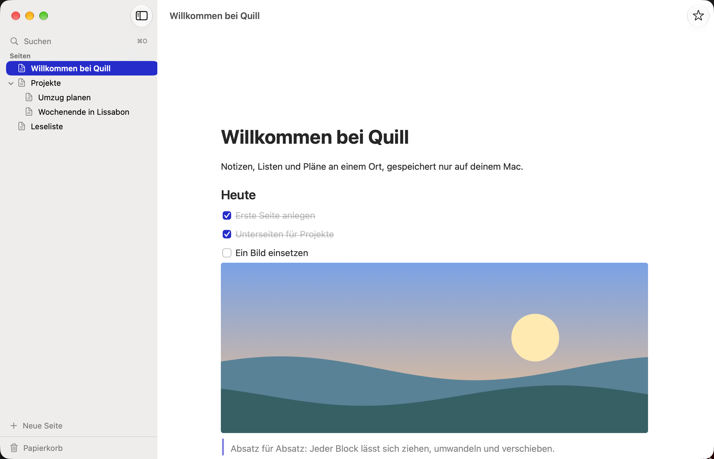

# Quill

Local-first Notizen- und Seiten-App für macOS: verschachtelte Seiten, Notizen und Aufgaben in einem nativen Block-Editor. Alle Daten bleiben auf deinem Mac. Ins Netz geht Quill nur, wenn du nach Updates suchst (ab v0.5.0, Standard aus).

<picture>
  <source media="(prefers-color-scheme: dark)" srcset="docs/images/quill-dunkel.png">
  
</picture>

> Status: [v0.5.0 veröffentlicht](../../releases/tag/v0.5.0) (nur Apple Silicon, macOS 26). Neu in v0.5.0: Updates in der App (aus, bis du zustimmst; **Quill › Nach Updates suchen …**) und ein Regler für Liquid Glass (**Einstellungen › Darstellung**). Seit v0.4.0: Zeitreise je Seite (**Seite › Zeitreise …**, ⌥⌘Y), lokale KI mit Apple Intelligence nur auf dem Gerät (Zusammenfassen, To-dos vorschlagen, Verwandte Seiten, Frag deine Notizen), Siri und Kurzbefehle, Spotlight, Schnellnotiz in der Menüleiste, Erinnerungen an To-dos, Tagesseite mit heutigen Terminen (⇧⌘T), Sprachnotiz, durchsuchbarer Text in Bildern, Präsentieren (⌥⌘P), Sync zwischen Macs über einen Ordner (Beta, aus bis zum Einschalten) und ein neues App-Icon. Seit v0.3.0: Fokus-Modus (⇧⌘F). Seit v0.2.0: sieben Themes für den Editor. Dazu Export als Markdown-Ordner (⇧⌘E), Schnell öffnen (⌘O), Favoriten, Papierkorb, Backups und ein Block-Editor mit Überschriften, Listen, To-dos, Zitat, Code, Trenner, Bildern, Inline-Formatierung, Slash-Menü und Markdown-Kürzeln. Pausiert: iPhone-App und Teilen-Erweiterung (brauchen das Developer Program). Offen: Verschlüsselung des Sync-Ordners (Phase 14). Plan in [`docs/roadmap.md`](docs/roadmap.md).

## Installation

Voraussetzung: Mac mit Apple Silicon, macOS 26 oder neuer. Die .dmg gibt es unter [Releases](../../releases).

Quill ist nur ad hoc signiert und nicht von Apple notarisiert. macOS blockiert deshalb den ersten Start, und du bestätigst ihn einmal selbst:

1. `Quill-<Version>.dmg` laden und öffnen.
2. Quill auf den Ordner „Programme“ im Fenster der .dmg ziehen. Danach die .dmg im Finder auswerfen.
3. Quill im Ordner „Programme“ öffnen. macOS meldet, dass Quill nicht geöffnet werden kann, weil Apple die App nicht auf Schadsoftware prüfen konnte. Die Meldung schließen, ohne Quill in den Papierkorb zu legen.
4. Systemeinstellungen › Datenschutz & Sicherheit öffnen und nach unten scrollen. Im Abschnitt zur Sicherheit steht ein Hinweis zu Quill. „Dennoch öffnen“ klicken und mit Passwort oder Touch ID bestätigen.
5. Quill erneut öffnen und in der Rückfrage das Öffnen bestätigen. Ab jetzt startet Quill normal.

**Updates (ab v0.5.0):** Quill fragt beim ersten Start einmal, ob es selbst nach Updates suchen soll; Standard ist „Nicht suchen“. Ändern unter **Einstellungen › Allgemein › Automatisch suchen**, von Hand über **Quill › Nach Updates suchen …**. Dabei fragt Quill höchstens einmal am Tag die Liste der Versionen bei GitHub ab, ohne Angaben über dich oder deinen Mac. Ein Update lädt Quill nur von `github.com/vogelwild07/quill` über HTTPS, prüft seine Signatur (Sparkle, EdDSA) und legt vor der Installation ein Backup an; installiert wird nur, wenn du zustimmst. Das klappt nur, wenn Quill im Ordner „Programme“ liegt. Fragt macOS nach dem Neustart, ob Quill auf die Daten der bisherigen Version zugreifen darf, erlaube das.

**Von v0.4.0 oder älter auf v0.5.0** aktualisierst du einmal von Hand mit der neuen .dmg, ab dann gehen Updates in der App. Jede neue Version ist neu signiert. Eventuell musst du Schritt 3 bis 5 wiederholen. macOS kann außerdem fragen, ob Quill auf die Daten der bisherigen Version zugreifen darf. Erlaube das, sonst findet Quill deine Seiten nicht. Deine Daten bleiben bei einem Update erhalten.

**Prüfsumme (optional):** `shasum -a 256 ~/Downloads/Quill-<Version>.dmg` muss mit der Datei `Quill-<Version>.dmg.sha256` im Release übereinstimmen.

## Voraussetzungen zum Bauen

- macOS 26 oder neuer, Apple Silicon
- Xcode 27+ (aktiv via `xcode-select`)
- Optional Signier-Team: `Config/Local.xcconfig.example` nach `Config/Local.xcconfig` kopieren und die eigene Team-ID eintragen. Die Datei wird nicht committet; ohne sie baut Xcode mit „Sign to Run Locally“.
- Für Pushes: `Config/Local.push-check.example` nach `Config/Local.push-check` kopieren und die eigene private E-Mail-Adresse eintragen. `Scripts/push.sh` prüft damit vor jedem Push, dass keine persönlichen Werte in Commits stehen.

## Bauen und testen

```sh
open Quill.xcodeproj           # Scheme „Quill“, ⌘R
# oder im Terminal:
xcodebuild -project Quill.xcodeproj -scheme Quill -destination 'platform=macOS' build
xcodebuild -project Quill.xcodeproj -scheme Quill -destination 'platform=macOS' test
swift test --package-path Packages/QuillKit
```

Release bauen: `Scripts/make-release.sh` erzeugt aus einer sauberen Arbeitskopie die ad hoc signierte, geprüfte App als `dist/Quill-<Version>.dmg` samt `.sha256` (ADR-022), mit gestaltetem Fenster und Volume-Icon (`Scripts/dmg/`, ADR-025), dazu den signierten Appcast `dist/appcast.xml` für Updates (ADR-037). Dafür muss der private Update-Schlüssel im Schlüsselbund liegen (Konto `io.github.vogelwild07.quill`); `Scripts/push.sh` braucht außerdem `Config/Local.update-key.sha256` (SHA-256 des Schlüssels, nicht committet) und bricht ab, sobald der Schlüssel in einem Commit steht.

Darstellung prüfen ohne Bildschirmfotos: `EditorSnapshotTests` und `EmptyStateSnapshotTests` rendern Editor und Leerzustände hell und dunkel und legen PNGs in `$TMPDIR/QuillEditorSnapshots/` ab. Die Bilder oben nimmt `Scripts/readme-screenshots.sh` auf (UI-Test mit Demo-Inhalten, Store nur im Arbeitsspeicher). Die Aufnahme liest Bildschirmpixel, deshalb vorher ein neutrales Schreibtischbild einstellen, andere Fenster ausblenden und „Nicht stören“ einschalten. Das App-Icon (`App/Resources/AppIcon.icon`) wird in Icon Composer bearbeitet. Performance: `python3 Scripts/perf-package.py 3` (Package, optimiert) und `python3 Scripts/perf-ui.py` (App im Schema „Quill Profiling“); Ziele und Messwerte in `docs/performance.md`. Der letzte Stand des Editor-Spikes aus Phase 1 ist der Git-Tag `editor-spike`.

## Daten und Backups

Die Datenbank liegt in `~/Library/Containers/io.github.vogelwild07.quill/Data/Library/Application Support/Quill/Store/`. Automatische Backups (beim Start höchstens einmal pro Tag, vor jeder Migration, vor einem Update, beim Beenden nach Änderungen) liegen daneben in `Backups/` und sind über **Ablage → Backups im Finder zeigen** erreichbar. Wiederherstellen über **Ablage → Backup wiederherstellen …**: Quill beendet sich und spielt das Backup beim nächsten Start ein, der vorherige Stand bleibt als Backup erhalten. Falls Quill nicht mehr startet: [von Hand](docs/data-model.md#backup-von-hand-wiederherstellen).

Sync zwischen Macs über einen Ordner (z. B. in iCloud Drive) ist seit v0.4.0 als Beta dabei (Phase 11, ADR-029). Er ist aus, bis man unter **Einstellungen › Sync** einen Ordner wählt; davor legt Quill ein Backup an. Jeder Mac schreibt dort nur eigene Dateien. Für den Handtest baut `Scripts/make-synctest.sh` die Testvarianten „Quill Synctest A“ und „Quill Synctest B“, jede mit eigenem Container; beide laufen zugleich in einem Benutzerkonto. Anleitung in `docs/synctest.md`; die meisten Fälle laufen auch automatisch mit `Scripts/test-synctest-ui.sh`.

Startargumente für UI-Tests:
Alle wirken nur aus der Kommandozeile und nur in Debug-Builds (ADR-019, ADR-021).
- `-QuillInMemoryStore YES`: Daten nur im Arbeitsspeicher, keine Backups.
- `-QuillStoreDirectory <Name>`: Datenbank und Backups in einem Unterordner des temporären Ordners der App (UI-Test über Neustarts).
- `-QuillPasteboardName <Name>`: Kopieren und Einsetzen im Editor über eine eigene Zwischenablage statt der allgemeinen.
- `-QuillTestImage <Breite>x<Höhe>|heavy|demo`: Die App legt ein selbst erzeugtes Testbild in diese eigene Zwischenablage (nur Debug).
- `-QuillWindowSize <Breite>x<Höhe>`: Das erste Fenster bekommt diese Größe in Punkten (für die Bilder oben).
- `-QuillEditorTheme <id>`: Theme des Editors (`standard`, `quill`, `tinte`, `sonne`, `lagune`, `abend`, `kontrast`), nur zusammen mit einem der Test-Stores; dann liest und speichert Quill die eigene Wahl nicht.
- `-QuillTestFocusMode YES`: Fokus-Modus beim Start, ebenso nur mit einem Test-Store.
- `-QuillTestGlass <0 … 1>` und `-QuillTestReduceTransparency YES`: Regler für Liquid Glass ohne „Wie System“ bzw. „Transparenz reduzieren“ fest, nur mit einem Test-Store.
- `-QuillUpdateTestFeed <Port>`: Updates bei `http://127.0.0.1:<Port>/appcast.xml` statt bei GitHub suchen, nur Debug und nur mit einem Test-Store (ohne das Argument suchen Test-Stores nie). Dazu `-QuillTestUpdateAutomatic YES` („Automatisch suchen“ an) und `-QuillTestUpdateAsk YES` (Frage beim ersten Start); Einstellungen dann nur im Speicher.
- `-QuillSyncTestFolder <Name>`: „Ordner wählen“ im Sync nimmt ohne Dateiauswahl diesen Unterordner des temporären Ordners der App, nur mit einem Test-Store. Test-Stores speichern die Einstellungen des Sync nie in denen des Macs.

## Struktur

- `App/` – macOS-App-Target (Scenes, Menüleiste, Ressourcen)
- `Packages/QuillKit/` – gesamte Logik: Model, Editor, Features, Export, Sync, Design
- `QuillUITests/` – UI-Tests
- `docs/` – [Architektur](docs/architecture.md), [Entscheidungen](docs/decisions.md), [Datenmodell](docs/data-model.md), [Design](docs/design.md), [Roadmap](docs/roadmap.md), [Product Brief](docs/product-brief.md)

## Lizenz

Copyright © 2026 vogelwild07. Der Quellcode ist freie Software: Du kannst ihn unter den Bedingungen der [GNU General Public License](LICENSE), wie von der Free Software Foundation veröffentlicht, weitergeben und verändern, entweder gemäß Version 3 der Lizenz oder (nach deiner Wahl) jeder späteren Version (SPDX: GPL-3.0-or-later). `LICENSE` enthält den unveränderten Text der Version 3.

**Ausgenommen ist das App-Icon** (`App/Resources/AppIcon.icon` und alle daraus erzeugten Bilder): alle Rechte vorbehalten, siehe [`ICON-LICENSE`](ICON-LICENSE). Wer Quill verändert und weitergibt, ersetzt das Icon durch ein eigenes.
